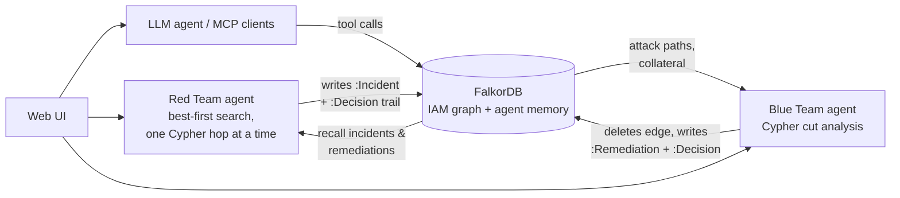
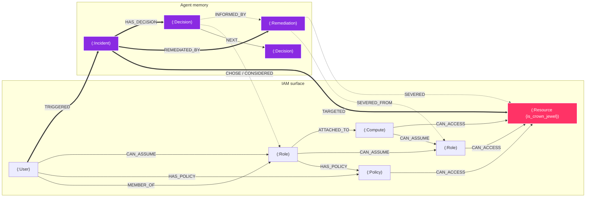

# ARGUS — Autonomous IAM Exposure Analyzer

**ARGUS finds the permission chains that let a low-privilege cloud identity reach your most sensitive data. It cuts them with the least collateral damage and remembers what it did.**
A Red Team agent and a Blue Team agent work over an IAM permission graph in FalkorDB. Their memory and every decision they make are stored in the same graph, so any answer can be traced back to the exact nodes, edges and past events behind it.

**Live demo:** https://argus-cknt.onrender.com (free tier: the first load after idle can take ~1 min) · **Demo video:** _add link_ · **Tracks:** Agents That Act on Connected Data · Agent Memory and Coordination

---

## The problem

In cloud IAM, the dangerous access is rarely a single permission. It's a chain like this:

> `DevIntern` can assume `CIRunnerRole` → that role is the instance profile of `BuildEC2` → `BuildEC2` can assume `BackendAppRole` → `BackendAppRole` can read `ProdCustomerVault`.

No single policy document shows this chain, and no single record holds it. The answer depends on how identities, roles, workloads and resources connect. That makes it a graph problem: one Cypher traversal answers what would otherwise mean joining policies again and again.

## What ARGUS does



1. **Find:** the Red Team agent starts from an identity and explores the graph one hop at a time. Each hop is one neighbour query. It keeps scored alternatives on a frontier and backtracks from dead ends. When it reaches a crown jewel, it writes an `:Incident` to the graph.
2. **Fix:** the Blue Team agent lists every edge on any attack path from that identity and asks FalkorDB which single edge, if removed, disconnects the identity from *all* crown jewels. It picks the one that breaks the fewest legitimate access paths. It applies the cut, records a `:Remediation` linked to both ends of the cut edge, re-verifies, and produces a Terraform patch.
3. **Remember:** every Red Team run starts by recalling past incidents and active remediations from the graph and checking that each cut edge is still gone. If a later change re-introduces a cut permission, the run reports **Regression Detected** and names the remediation that was undone.
4. **Explain:** every step of both agents is a `:Decision` node. It is linked to the node the agent chose, the alternatives it scored, and the memories that informed it. One Cypher query replays the whole story of an incident: the hops that found it, the cuts that were considered, and the fix that was applied.

Remove FalkorDB and nothing works: paths, cuts, memory, regression checks and decision traces are all Cypher queries. The backend returns HTTP 503 rather than falling back to anything else.

## Features

| | |
|---|---|
| **Red Team agent** | Best-first, hop-by-hop graph exploration with backtracking; regression detection from remembered remediations |
| **Blue Team agent** | Cypher-based single-edge cut with collateral scoring, a greedy multi-edge fallback, apply / verify / undo, and Terraform patches |
| **Decision Trail** | Replays an incident's decisions from both agents, with the Cypher query behind them |
| **Triage** | Ranks every permission edge by crown-jewel reachability, destination sensitivity, betweenness and blast radius |
| **Chokepoints** | `algo.betweenness` over the attack relationship types |
| **LLM agent** | Tool-calling loop (recall → triage → explain → propose → apply) streamed over SSE. The LLM narrates only paths the graph returned |
| **MCP server** | The same tools exposed to any MCP client at `/mcp` |
| **Cypher Playground** | Run your own read-only queries against the live graph |

---

## Graph Data Model

All edges point in the **attack direction**: whoever controls the source can reach the target.
That is why one variable-length traversal answers "what can this identity reach?".

### Diagram



### Nodes

| Label | Key properties | Role |
|-------|---------------|------|
| `User` | `name`, `department`, `is_compromised` | IAM identity (attacker entry point) |
| `Role` | `name`, `trust_policy` | Assumable IAM role |
| `Policy` | `name`, `effect`, `actions` | Identity-based policy |
| `Compute` | `name`, `type`, `instance_profile` | EC2 instance / Lambda function |
| `Resource` | `name`, `type`, `sensitivity`, `is_crown_jewel` | S3 bucket / KMS key / database |
| `Incident` | `id`, `entrypoint`, `target`, `hops`, `path_chain`, `regression` | Episodic memory of an attack path that was found |
| `Remediation` | `id`, `src`, `dst`, `type`, `edge_properties`, `status` (`applied` / `reverted`) | A cut edge, kept so it can be restored or checked for regression |
| `Decision` | `id`, `agent_id`, `run_id`, `step`, `action`, `reason`, `score` | One agent decision |

### Relationships: attack surface

| Rel type | From → To | Meaning | Properties |
|---|---|---|---|
| `MEMBER_OF` | User → Role | User is a member of the role (group / SSO permission set) | none |
| `HAS_POLICY` | User, Role → Policy | Identity-based policy attached to the principal | `attachment`: `managed` \| `inline` |
| `CAN_ASSUME` | User, Role, Compute → Role | Principal or workload can obtain the role's credentials | `technique`: `sts:AssumeRole`, `iam:PassRole`, `iam:UpdateAssumeRolePolicy`; optional `granted_by` (policy name) |
| `ATTACHED_TO` | Role → Compute | Role is bound to the workload (instance profile / execution role) | `binding`: `instance-profile` \| `execution-role` |
| `CAN_ACCESS` | Role, Policy, Compute → Resource | Data-plane access to the resource | `permission`, e.g. `s3:GetObject`, `kms:Decrypt` |

`tests/test_seed_model.py` enforces this schema with Cypher: no edge may break its label pairs, and required properties must be present.

### Relationships: memory and provenance

| Rel type | From → To | Meaning |
|---|---|---|
| `TRIGGERED` | User → Incident | Who the attack path started from |
| `TARGETED` | Incident → Resource | Which crown jewel was reached |
| `REMEDIATED_BY` | Incident → Remediation | Which remediation closed it |
| `SEVERED_FROM` / `SEVERED` | Remediation → source / target node | The two ends of the cut edge |
| `HAS_DECISION` | Incident → Decision | Decisions made during the run that found it |
| `NEXT` | Decision → Decision | Order of decisions within a run |
| `CHOSE` | Decision → infra node | The hop the agent committed to |
| `CONSIDERED {score}` | Decision → infra node | Alternatives the agent scored but did not take |
| `INFORMED_BY` | Decision → Incident / Remediation | Memory that influenced the decision |

### Planted scenarios (synthetic, `SEED=42`)

| Entrypoint | Path | Escalation technique |
|---|---|---|
| DevIntern | DevIntern → CIRunnerRole → BuildEC2 → BackendAppRole → ProdCustomerVault | assume a CI role, then use the build host's instance profile |
| Contractor | Contractor → AdminRole → KMSDecryptPolicy → ProdKMSKey | `iam:UpdateAssumeRolePolicy` granted by AttachPolicyPermissions |
| SupportUser | SupportUser → SupportOpsRole → SupportLambda → DynamoDBReaderRole → CrownJewelDB | `iam:PassRole` from a Lambda execution role |

The remaining ~140 nodes are 13 synthetic product teams (`payments-dev-role`, `fraud-api-ec2`, …). Their edges never reach a crown jewel, which the tests also check.

---

## Key Cypher Queries

```cypher
// Shortest attack path (FalkorDB: shortestPath only inside WITH/RETURN)
MATCH (u:User {name: $n}), (t:Resource {is_crown_jewel: true})
WITH u, t, shortestPath((u)-[:MEMBER_OF|HAS_POLICY|CAN_ASSUME|ATTACHED_TO|CAN_ACCESS*1..8]->(t)) AS p
WHERE p IS NOT NULL
RETURN [n IN nodes(p) | n.name], length(p) ORDER BY length(p)

// Betweenness centrality over attack edges (chokepoint ranking)
CALL algo.betweenness({
  relationshipTypes: ['MEMBER_OF','HAS_POLICY','CAN_ASSUME','ATTACHED_TO','CAN_ACCESS'],
  samplingSeed: 42
}) YIELD node, score
RETURN node.name, score ORDER BY score DESC LIMIT 10

// Link a remediation into the topology (both ends of the cut edge)
MATCH (r:Remediation {id: $rid})
OPTIONAL MATCH (s) WHERE s.name = $s AND (s:User OR s:Role OR s:Policy OR s:Compute OR s:Resource)
OPTIONAL MATCH (d) WHERE d.name = $d AND (d:User OR d:Role OR d:Policy OR d:Compute OR d:Resource)
FOREACH (_ IN CASE WHEN s IS NULL THEN [] ELSE [1] END | CREATE (r)-[:SEVERED_FROM]->(s))
FOREACH (_ IN CASE WHEN d IS NULL THEN [] ELSE [1] END | CREATE (r)-[:SEVERED]->(d))

// Red Team memory recall at the start of every run
MATCH (s)<-[:SEVERED_FROM]-(r:Remediation)-[:SEVERED]->(d)
WHERE coalesce(r.status, 'applied') <> 'reverted'
RETURN s.name, d.name, r.id, r.type

// Record one decision and chain it to the previous one
CREATE (d:Decision) SET d = $p
MATCH (d:Decision {id: $id}) MATCH (n) WHERE n.name = $chosen CREATE (d)-[:CHOSE]->(n)
MATCH (d:Decision {id: $id}) UNWIND $considered AS c MATCH (n) WHERE n.name = c.name
  CREATE (d)-[:CONSIDERED {score: c.score}]->(n)
MATCH (d:Decision {id: $id}) UNWIND $ids AS mid MATCH (m) WHERE m.id = mid AND (m:Incident OR m:Remediation)
  CREATE (d)-[:INFORMED_BY]->(m)
MATCH (prev:Decision {run_id: $run_id, step: $prev_step}), (d:Decision {id: $id}) CREATE (prev)-[:NEXT]->(d)

// "Why did the agent do that?" (decision trace for a run)
MATCH (d:Decision) WHERE d.run_id = $run_id
OPTIONAL MATCH (d)-[:CHOSE]->(c)
OPTIONAL MATCH (d)-[cr:CONSIDERED]->(alt)
WITH d, c, collect(CASE WHEN alt IS NULL THEN NULL ELSE {name: alt.name, score: cr.score} END) AS considered
OPTIONAL MATCH (d)-[:INFORMED_BY]->(m)
WITH d, c, considered, collect(CASE WHEN m IS NULL THEN NULL ELSE {id: m.id, label: labels(m)[0]} END) AS informed
RETURN properties(d), c.name, considered, informed ORDER BY d.agent_id, d.step

// ── Blue Team cut analysis (backend/agents/blue_team.py), R = MEMBER_OF|HAS_POLICY|CAN_ASSUME|ATTACHED_TO|CAN_ACCESS

// 1. Candidate cut edges: every edge on an attack path, ranked by how many paths it carries
MATCH p=(s)-[:R*1..8]->(cj:Resource {is_crown_jewel: true})
WHERE s.name = $src AND NONE(x IN relationships(p) WHERE id(x) IN $removed)
UNWIND range(0, length(p)-1) AS i
WITH relationships(p)[i] AS r, i
RETURN id(r), startNode(r).name, endNode(r).name, type(r), count(*) AS paths, min(i) AS hop
ORDER BY paths DESC, hop DESC

// 2. Does the entrypoint stay disconnected if this edge is cut? (all candidates in one query)
UNWIND $cuts AS cut
OPTIONAL MATCH p=(s)-[:R*1..8]->(cj:Resource {is_crown_jewel: true})
WHERE s.name = $src AND NONE(x IN relationships(p) WHERE id(x) IN cut)
RETURN cut, count(p)

// 3. Collateral: legitimate identity→resource pairs that only go through this edge
MATCH (a)-[e]->(b) WHERE id(e) = $eid
WITH a, e, b
MATCH up=(u:User)-[:R*0..7]->(a)
WITH u, min(length(up)) AS du, e, b
MATCH dn=(b)-[:R*0..7]->(n)
WHERE NOT coalesce(n.is_crown_jewel, false) AND du + 1 + length(dn) <= 8
WITH DISTINCT u, n, e
OPTIONAL MATCH alt=(u)-[:R*1..8]->(n) WHERE NONE(x IN relationships(alt) WHERE id(x) = id(e))
WITH u, n, count(alt) AS alternatives WHERE alternatives = 0
RETURN count(*)

// 4. Regression check: do remembered cut edges exist again?
UNWIND $pairs AS p
OPTIONAL MATCH (a)-[r:MEMBER_OF|HAS_POLICY|CAN_ASSUME|ATTACHED_TO|CAN_ACCESS]->(b)
WHERE a.name = p.s AND b.name = p.d
RETURN p.s, p.d, count(r)
```

---

## FalkorDB notes (4.18)

- `shortestPath()` is valid **only** inside `WITH` or `RETURN` clauses, not in `MATCH p = shortestPath(...)`.
- `algo.betweenness` with `relationshipTypes` and `samplingSeed` works on FalkorDB 4.18.
- `EXISTS { }` subqueries do not parse; use `OPTIONAL MATCH ... count()` instead.
- In the collateral query, a `WITH a, e, b` after the first `MATCH` is required for correct results when the next `MATCH` reuses those variables.
- The Blue Team cut is computed with bounded (≤ 8 hop) path queries rather than `algo.maxFlow`, so that it can score collateral per candidate edge.
- Runtime is available as `result.run_time_ms`.
- Fast batch seeding: `UNWIND $rows AS r CREATE (n:Label) SET n = r`.

---

## Running ARGUS

### Option 1: Docker (everything, one command)

```bash
cp .env.example .env        # optional: add LLM_API_KEY (Groq) for the LLM agent and Copilot
docker compose up -d --build
```

| URL | What |
|---|---|
| http://localhost:8001 | ARGUS web UI |
| http://localhost:8001/docs | API (OpenAPI) |
| http://localhost:3000 | FalkorDB browser |

The demo graph is seeded automatically the first time the app connects to an empty FalkorDB.
To reset it, call `POST /api/graph/reseed`. Agent memory is kept.

### Option 2: Local development

```bash
docker compose up -d falkordb                     # FalkorDB only

python -m venv .venv
.venv/Scripts/activate                            # Windows  (macOS/Linux: source .venv/bin/activate)
pip install -r requirements.txt
cp .env.example .env
uvicorn backend.main:app --reload --port 8001     # API on :8001

cd frontend && npm install && npm run dev         # UI on :5173, proxies /api to :8001
```

### Option 3: Deploy (Render + FalkorDB Cloud)

1. Create a free FalkorDB Cloud instance at https://app.falkordb.cloud and note its host, port, username and password.
2. On Render, choose **New → Blueprint**, select this repository, and fill in the values `render.yaml` asks for: the `FALKORDB_*` settings, and `LLM_API_KEY` if you want the LLM features.
3. Open the service URL. The graph is seeded on first start.

The image is a single container. It builds the React UI, serves it from FastAPI and reads `PORT`, so it also runs as-is on Railway, Fly.io or any Docker host.

### Configuration

| Variable | Default | Purpose |
|---|---|---|
| `FALKORDB_HOST` / `FALKORDB_PORT` | `localhost` / `6379` | FalkorDB connection |
| `FALKORDB_USERNAME` / `FALKORDB_PASSWORD` | none | Needed for FalkorDB Cloud |
| `GRAPH_NAME` | `ArgusCloud` | Graph key in FalkorDB |
| `LLM_API_KEY` | none | Groq (or other OpenAI-compatible) key. Optional: the graph agents, triage, trail and playground work without it |
| `LLM_BASE_URL` / `LLM_MODEL` | Groq / auto | LLM endpoint and model |
| `LLM_STAGE_MODE` | `false` | Replay cached LLM answers only (offline demos) |

### Tests

```bash
GRAPH_NAME=ArgusTest python -m pytest -q     # needs FalkorDB; use a separate graph name
```

| Test file | Covers |
|---|---|
| `test_seed_model.py` | Every edge obeys the schema (checked with Cypher); only the planted identities reach crown jewels |
| `test_cypher_traversals.py` | Shortest path, blast radius, what-if queries |
| `test_blue_team_cypher.py` | Cut selection, apply / verify / undo, Terraform patches, multi-edge fallback |
| `test_memory_trace.py` | Remediation memory, regression detection, decision chains and the trace API |
| `test_e2e_pipeline.py`, `test_api_routes.py` | End-to-end attack → remediate → verify, API contracts, read-only playground |

---

## API

| Endpoint | Purpose |
|---|---|
| `POST /api/simulate/attack` | Run the Red Team agent from an `entrypoint` |
| `POST /api/simulate/remediate` | Blue Team cut plan for an attack result |
| `POST /api/simulate/apply-patch` / `undo-patch` | Apply or revert a cut |
| `GET /api/trace/latest?entrypoint=` | Decision trail of the latest incident for an identity |
| `GET /api/trace/run/{run_id}` / `incident/{incident_id}` | Decision trail by run or incident |
| `GET /api/triage` / `GET /api/triage/chokepoints` | Ranked findings / betweenness chokepoints |
| `GET /api/agent/stream` | LLM tool-calling agent (SSE) |
| `POST /api/graph/cypher` | Read-only Cypher (`GRAPH.RO_QUERY`) |
| `GET /health` | FalkorDB connectivity |

## MCP server

ARGUS exposes its tools over MCP (SSE transport) at `/mcp`:

| Tool | Description |
|------|-------------|
| `triage` | Ranked permission-edge findings |
| `explain_path` | Shortest attack path for an identity |
| `propose_fix` | Blue Team cut recommendation |
| `apply_fix` | Apply the cut in FalkorDB |
| `recall_incidents` | Episodic memory of past attacks |

---

## Project structure

```
backend/
  agents/red_team.py      Best-first explorer, memory recall, regression detection, decisions
  agents/blue_team.py     Cypher cut analysis, collateral, apply/undo, Terraform patches
  db/falkor.py            FalkorDB client: traversals, memory, remediation links, decision provenance
  db/seed_data.py         Synthetic IAM graph (SEED=42) + schema validation
  routers/                attack, trace, triage, graph, agent (LLM), rag, swarm, stream
  llm.py                  OpenAI-compatible client (Groq by default)
  mcp_server.py           MCP tools
  main.py                 FastAPI app; also serves the built UI
frontend/src/components/  Dashboard, Investigate, Agent, Decision Trail, Triage, Cypher, ...
tests/                    Pytest suites (run against a live FalkorDB)
Dockerfile                Builds UI + backend into one image
docker-compose.yml        FalkorDB + ARGUS
render.yaml               Render deployment blueprint
```

## Data and AI use

- **Data:** the IAM graph is fully synthetic and generated deterministically (`SEED=42`). It contains no real accounts, credentials or personal data.
- **AI assistance:** Claude (Anthropic) was used as a coding assistant. The runtime LLM agent uses Groq `llama-3.3-70b-versatile`.

## Stack

FalkorDB · Python 3.11 · FastAPI · React 18 + Vite + TypeScript + Tailwind · MCP · Groq
