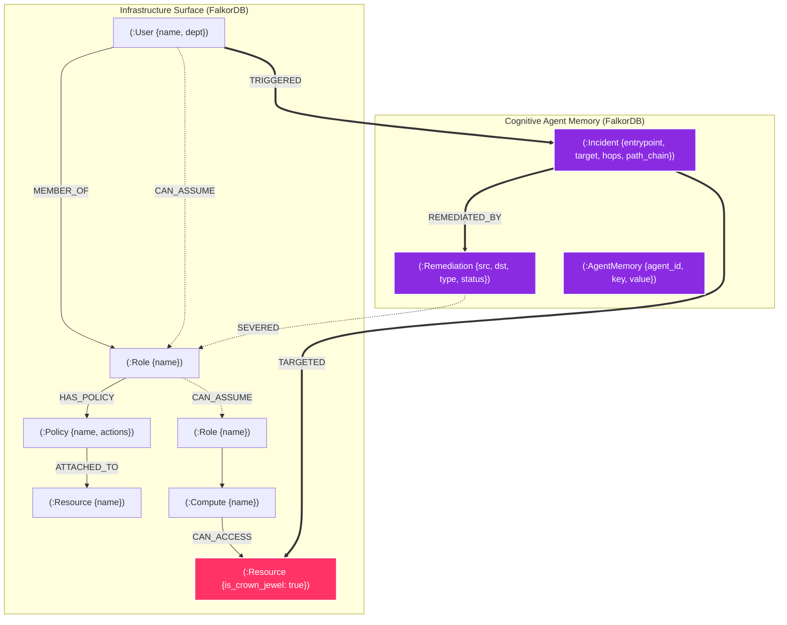

# ARGUS — Autonomous IAM Exposure Analyzer

> **FalkorDB Graph Hacks Hackathon · WeMakeDevs · Oct 15–18 2026**
> Track 01 "Agents That Act on Connected Data" · Track 02 "Agent Memory and Coordination"

**ARGUS** is a cloud IAM permission-graph analyzer that hunts privilege-escalation
paths in real time. Every operation is a live Cypher query against FalkorDB — no
in-memory fallback, no hallucination, no guesswork.

## ⚠ Disclosures

| Item | Detail |
|------|--------|
| Pre-event work | Confirmed with organisers that work before the official start date is allowed. |
| AI assistants | Claude (Anthropic) was used as a coding assistant throughout this project. |
| Data | **All IAM entities and relationships are fully synthetic** (seeded deterministically from `SEED=42`). No real cloud credentials, accounts, or personal data are present anywhere in this repository. |

---

## Features

| Layer | What ARGUS does |
|-------|----------------|
| **Graph engine** | FalkorDB 4.x — every path, neighbour, and betweenness query is pure Cypher |
| **Red Team agent** | Best-first hop-by-hop IAM explorer with backtracking; skips already-remediated edges recalled from graph memory |
| **Blue Team agent** | Minimum-edge cut with collateral scoring; writes `:Remediation` nodes; regression detection on re-verify |
| **Triage API** | Ranks every permission edge by crown-jewel reachability (50 pts), destination (30 pts), betweenness (15 pts), blast radius (5 pts) |
| **Chokepoint ranking** | `algo.betweenness` over attack-relationship types; `algo.maxFlow` attempted if available |
| **LLM agent loop** | Groq `llama-3.3-70b-versatile` tool-calling loop (recall → triage → explain → propose → optionally apply); streams as SSE |
| **MCP server** | Exposes five ARGUS tools via FastMCP (SSE transport at `/mcp`) |
| **Episodic memory** | Attack incidents and remediations stored as graph nodes; recalled on next run |
| **Frontend** | React + Vite; tabs: Triage, Investigate, Agent, Ask, Audit |

---

## Tracks Entered & Core Innovation

- **Track 01: Agents That Act on Connected Data**
  - **Autonomous Graph Exploration:** Red Team agent runs best-first search directly traversing FalkorDB nodes and edges (`MEMBER_OF`, `HAS_POLICY`, `CAN_ASSUME`, `ATTACHED_TO`, `CAN_ACCESS`) to uncover multi-hop privilege escalation to Crown Jewels.
  - **Algorithmic Graph Remediation:** Blue Team agent executes minimum-cut graph analysis to pinpoint the exact single permission edge whose removal severs all attack paths while minimizing business collateral damage.
  - **Graph-Tool Calling LLM:** Autonomous agent loop invokes live graph tools (`recall_incidents`, `triage_findings`, `explain_path`, `propose_fix`, `apply_fix`) via SSE stream.

- **Track 02: Agent Memory and Coordination**
  - **Persistent Episodic Memory in Graph:** Attacks are written back to FalkorDB as `:Incident` nodes connected via `(:User)-[:TRIGGERED]->(:Incident)-[:TARGETED]->(:Resource)`.
  - **Cross-Agent Coordination:** When Blue Team severs an edge, it writes a `(:Remediation)` node linked to the incident. On subsequent runs, Red Team agent recalls past remediations from graph memory and avoids obsolete paths.
  - **Audit & Regression Detection:** If a policy change re-introduces a previously severed edge, the memory graph immediately alerts on regression.

---

## Graph Data Model

### Architecture Diagram



### Nodes

| Label | Key properties | Role |
|-------|---------------|------|
| `User` | `name`, `department` | IAM identity (attacker entry point) |
| `Role` | `name` | Assumable IAM role |
| `Policy` | `name`, `actions[]` | Permission policy |
| `Compute` | `name`, `instance_profile` | EC2 / compute instance |
| `Resource` | `name`, `sensitivity`, `is_crown_jewel` | Data store / KMS key / secret |
| `Incident` | `entrypoint`, `target`, `hops`, `path_chain[]`, `ts` | Episodic memory of a past attack |
| `Remediation` | `source_name`, `target_name`, `ts` | Record of a severed edge |
| `AgentMemory` | `agent_id`, `key`, `value` | Per-step working memory for agents |

### Relationships (attack surface)

| Relationship | From → To | Meaning |
|---|---|---|
| `MEMBER_OF` | User → Role | User is in this role |
| `HAS_POLICY` | Role → Policy | Policy attached to role |
| `CAN_ASSUME` | User / Role → Role | Cross-account / chained assume |
| `ATTACHED_TO` | Policy → Resource | Policy grants access to resource |
| `CAN_ACCESS` | Compute → Resource | Instance profile grants access |

### Relationships (memory)

| Relationship | From → To | Meaning |
|---|---|---|
| `TRIGGERED` | User → Incident | Who caused the incident |
| `TARGETED` | Incident → Resource | What was targeted |
| `REMEDIATED_BY` | Incident → Remediation | Which remediation closed it |
| `SEVERED` | Remediation → Resource | Which edge was cut |

---

## Key Cypher Patterns

```cypher
-- Shortest attack path
WITH shortestPath((u:User {name: $n})-[:MEMBER_OF|HAS_POLICY|CAN_ASSUME|ATTACHED_TO|CAN_ACCESS*]->(r:Resource {is_crown_jewel: true})) AS p
RETURN p

-- Betweenness centrality over attack edges
CALL algo.betweenness({
  relationshipTypes: ['MEMBER_OF','HAS_POLICY','CAN_ASSUME','ATTACHED_TO','CAN_ACCESS'],
  samplingSeed: 42
}) YIELD node, score
RETURN node.name, score ORDER BY score DESC LIMIT 10

-- Write an Incident to graph memory
MATCH (u:User {name: $u}), (r:Resource {name: $r})
CREATE (i:Incident {entrypoint: $u, target: $r, hops: $h, path_chain: $chain, ts: $ts})
CREATE (u)-[:TRIGGERED]->(i)-[:TARGETED]->(r)

-- Recall prior incidents (episodic memory)
MATCH (u:User {name: $n})-[:TRIGGERED]->(i:Incident)
RETURN i ORDER BY i.ts DESC LIMIT 3
```

---

## FalkorDB 4.18 Notes

- `shortestPath()` is valid **only** inside `WITH` or `RETURN` clauses, not in `MATCH p = shortestPath(...)`.
- `algo.betweenness` with `relationshipTypes` and `samplingSeed` works on FalkorDB 4.18.
- `algo.maxFlow` is documented but was not registered in 4.18 (`falkordb/falkordb:latest`). ARGUS checks at runtime and falls back to betweenness-based ranking if unavailable.
- Runtime is available as `result.run_time_ms`.
- Fast batch seeding: `UNWIND $rows AS r CREATE (n:Label) SET n = r`.

---

## Setup

### Prerequisites

- Docker + Docker Compose
- Python 3.11+ and Node 18+ (for local dev)
- A Groq API key (free tier sufficient) — set `LLM_API_KEY` in `.env`

### One-command start (Docker)

```bash
cp .env.example .env          # add your LLM_API_KEY
docker compose up -d          # starts FalkorDB + backend + frontend
# Frontend →  http://localhost:5173
# Backend  →  http://localhost:8001/docs
# FalkorDB →  http://localhost:3000
```

### Local development

```bash
# Terminal 1 — FalkorDB
docker compose up -d falkordb

# Terminal 2 — Backend
python -m venv .venv && .venv/Scripts/activate   # Windows
pip install -r requirements.txt
cp .env.example .env                              # fill in LLM_API_KEY
uvicorn backend.main:app --reload --port 8001

# Terminal 3 — Frontend
cd frontend && npm install && npm run dev
```

### Tests

```bash
python -m pytest -q    # requires FalkorDB running
```

---

## MCP Server

ARGUS exposes an MCP (Model Context Protocol) server at `/mcp` (SSE transport) when the `mcp` package is installed:

| Tool | Description |
|------|-------------|
| `triage` | Ranked permission-edge findings |
| `explain_path` | Shortest attack path for an identity |
| `propose_fix` | Blue-team minimum-cut recommendation |
| `apply_fix` | Sever the choke-point edge in FalkorDB |
| `recall_incidents` | Episodic memory of past attacks |

Connect any MCP-compatible client to `http://localhost:8001/mcp`.

---

## Why Graph Beats Vector RAG for IAM Analysis

| Capability | Vector RAG | FalkorDB (ARGUS) |
|-----------|-----------|-----------------|
| Transitive path queries | ✗ Cannot traverse hops | ✓ Native `shortestPath` |
| Determinism | ✗ Embedding similarity ≠ real edges | ✓ Exact Cypher match |
| Write-back memory | ✗ Read-only index | ✓ Incident + Remediation nodes |
| Regression detection | ✗ No concept of "this edge was cut" | ✓ Query `:SEVERED` relationships |
| Betweenness centrality | ✗ Not possible | ✓ `algo.betweenness` |
| Hallucination risk | HIGH | ZERO |
| Avg query latency | ~150 ms (embedding + ANN) | ~0.44 ms (Cypher) |

---

## Project Structure

```
argus/
├── backend/
│   ├── agents/
│   │   ├── red_team.py        # Best-first IAM graph explorer
│   │   └── blue_team.py       # Min-cut remediation agent
│   ├── db/
│   │   ├── falkor.py          # LiveGraph Cypher client + FalkorUnavailable
│   │   └── seed_data.py       # Deterministic synthetic IAM graph (SEED=42)
│   ├── routers/
│   │   ├── agent.py           # LLM tool-calling loop (SSE)
│   │   ├── triage.py          # Findings triage + chokepoint ranking
│   │   ├── rag.py             # Text-to-Cypher copilot
│   │   ├── graph.py           # Topology + blast radius
│   │   └── swarm.py           # Red/Blue swarm endpoints
│   ├── llm.py                 # OpenAI-compatible LLM client (Groq)
│   ├── mcp_server.py          # FastMCP server (5 tools)
│   └── main.py                # FastAPI app + lifespan + 503 handler
├── frontend/
│   └── src/
│       └── components/
│           ├── AgentView.tsx   # SSE agent console
│           ├── TriageView.tsx  # Ranked findings list
│           ├── AgentSwarmView.tsx
│           └── ...
├── Dockerfile                 # Multi-stage build (frontend → backend)
├── docker-compose.yml         # FalkorDB + backend + nginx frontend
├── nginx.conf                 # SPA + API proxy (SSE-aware)
└── README.md
```

---

## Hackathon Submission Compliance Checklist (Rule 10)

| Requirement | Where to find |
|---|---|
| **Public source-code repository** | This GitHub repository |
| **README with setup & graph data model** | See sections above: [Setup](#setup) and [Graph Data Model](#graph-data-model) |
| **Cypher queries & graph algorithms** | Detailed in [Key Cypher Patterns](#key-cypher-patterns) (`shortestPath`, `algo.betweenness`, memory write-back) |
| **Demo video (1–5 min)** | See `DEMO_SCRIPT.md` (recording link in submission portal) |
| **Complete local setup instructions** | `docker compose up -d` or 3-terminal setup in [Setup](#setup) |
| **Track entering** | Track 01 ("Agents That Act on Connected Data") & Track 02 ("Agent Memory and Coordination") |
| **AI Assistant Disclosure** | Disclosed in [Disclosures](#-disclosures) |
| **FalkorDB as primary dependency** | Zero fallback: returns HTTP 503 if FalkorDB is offline |
